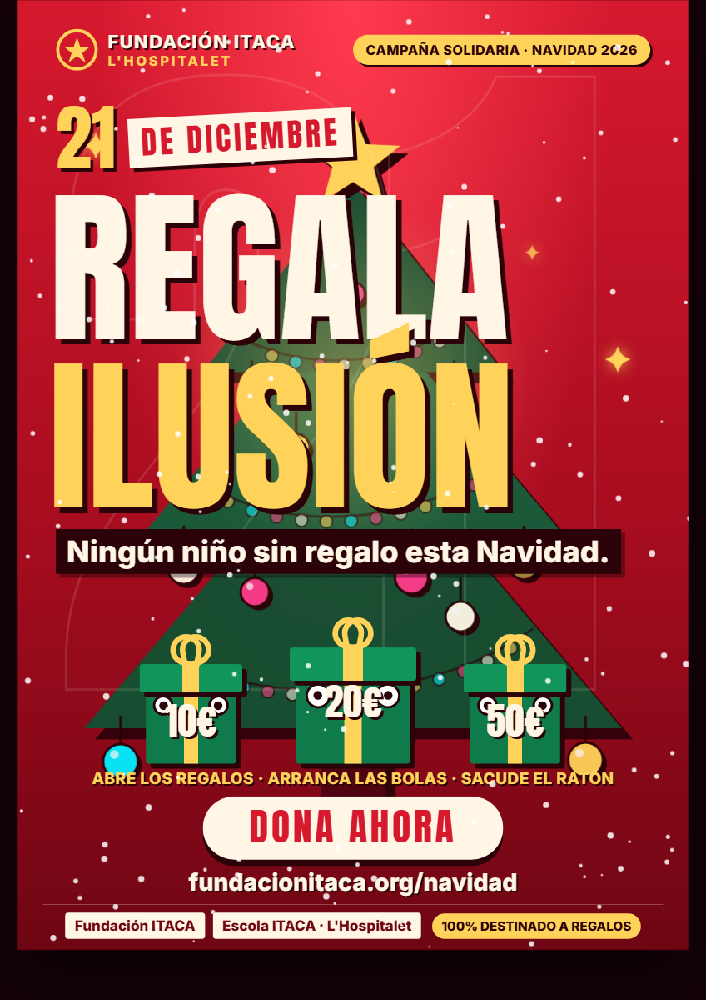

# REGALA ILUSIÓN · Cartel interactivo

**Actividad 0612 · The Interactive Poster** · Desarrollo web en entorno cliente
Campaña de Navidad de la **Fundación ITACA L'Hospitalet** · **21 de diciembre**

## Concepto

Cartel digital (848 × 1200 px, A3 vertical) que invita a donar una pequeña cantidad para comprar regalos de Navidad a niños y niñas en riesgo de exclusión.

El usuario puede **"abrir" los regalos con el cursor**: cada caja muestra qué consigue su donación (10 € = 1 juguete, 20 € = 1 lote completo, 50 € = regalos para 5 niños). Al abrir los tres aparece un sello de **¡GRACIAS!**, que es el estado final del cartel.

- Paleta roja, dorada y crema (Navidad), tipografía condensada **Anton** a gran tamaño para que se lea de lejos.
- Un **árbol de Navidad gigante** de fondo (plano, con sombra dura como los regalos, que quedan a sus pies), un "21" gigante, nieve que cae y una luz cálida que sigue al cursor.
- Y efectos absurdos porque sí: el cursor es una **lente que invierte los colores** con un **arbolito** con luces dentro que se balancea, remueve una **tinta fluida** de colores (*splash cursor*) y deja una estela de **cristales de nieve**, el ratón **controla el viento** de la nevada, los regalos tienen **ojos saltones** que te siguen, un **clic deforma todo el cartel** como una onda en el agua y si **sacudes el ratón** hay un terremoto con lluvia de confeti.

## Archivos

| Archivo | Contenido |
|---|---|
| `index.html` | Estructura del cartel |
| `style.css` | Maquetación, colores, tipografía y transiciones |
| `main.js` | Toda la lógica de interacción |

Para verlo basta con abrir `index.html` en el navegador. El cartel se escala proporcionalmente si la ventana es más pequeña (función `fitPoster()`).

## Eventos de JavaScript utilizados

Todos los eventos se registran con `addEventListener()`:

| Evento | Elemento | Qué hace |
|---|---|---|
| `mouseenter` | Letras del titular, regalos, botón, fecha | Activa la reacción visual y agranda la lente-cursor |
| `mouseleave` | Letras del titular, regalos, botón, fecha, cartel | Recupera el estado inicial y encoge la lente |
| `mousemove` | Cartel completo, botón | Glitch, tinta fluida, cristales de nieve, ojos, lente con arbolito, parallax, luz, nieve y viento, terremoto y botón magnético |
| `mousedown` / `mouseup` | Cartel / `window` | Agarrar y soltar bolas del árbol y nudos de las guirnaldas (`grabTree()`, `releaseTree()`) |
| `click` | Cartel | Onda expansiva que deforma el cartel, salpica tinta y dispara la nieve (`shockwave()`, `splashFluid()`, `blowSnow()`) |
| `resize` | `window` | Reescala el cartel |
| `animationend` | Escenario | Limpia el estado al acabar el terremoto |

## Las tres interacciones

### 1 · `mouseenter`
- **Titular "REGALA ILUSIÓN"**: el texto se divide en letras (`splitIntoLetters()`). Al entrar en una letra, `handleLetterEnter()` la hace saltar, la gira un ángulo aleatorio, la agranda y cambia su color y sombra, y `scrambleLetter()` la "descodifica" mostrando símbolos aleatorios antes de volver a la letra original.
- **Regalos**: `openGift()` levanta y gira la tapa, ilumina la caja, sube la etiqueta con el importe, muestra el texto oculto y lanza una explosión de destellos (`burstSparkles()`, con la Web Animations API). `registerOpenedGift()` cuenta los regalos abiertos y, al llegar a tres, muestra el sello **¡GRACIAS!**.
- **Botón "DONA AHORA"**: `handleCtaEnter()` cambia el fondo, el color del texto y la sombra.

### 2 · `mouseleave`
- `handleLetterLeave()`, `closeGift()` y `handleCtaLeave()` borran los estilos en línea y el elemento vuelve a su estado inicial con una transición CSS elástica.
- `growLens()` / `shrinkLens()`: la **lente-cursor** (un círculo con `backdrop-filter: invert() hue-rotate()`) crece al entrar en cualquier elemento interactivo y se encoge al salir.
- `handlePosterLeave()` recoloca la luz y las capas de parallax en el centro y la nieve deja de apartarse.

### 3 · `mousemove`
- `handlePosterMove()` convierte la posición del ratón a coordenadas del cartel (`getPosterCoords()`, teniendo en cuenta la escala) y:
  - calcula la **velocidad del ratón** y la usa para un **glitch RGB** en el titular (`updateGlitch()`): las dos líneas se desplazan y deforman en sentidos opuestos con sombras cian/magenta; cuanto más rápido mueves el ratón, más se rompe el texto;
  - mueve una **luz radial** que sigue al cursor (variables CSS `--mx` / `--my`);
  - desplaza las capas con `data-depth` (el "21" gigante y las estrellas) para crear un **efecto de profundidad**;
  - mueve la **lente** que invierte los colores (`moveLens()`); dentro lleva un **arbolito** SVG que se inclina en sentido contrario al movimiento y vuelve a ponerse recto (`updateTreeTilt()`);
  - suelta una **estela de cristales de nieve** (❅ ❆ ✻) que giran, caen y se desvanecen (`spawnCrystal()` / `drawCrystals()`);
  - remueve una **tinta fluida** (*splash cursor*, `stirFluid()`): una simulación de fluidos en WebGL2 (`createFluid()`, basada en la técnica de Pavel Dobryakov, licencia MIT) que calcula velocidad, presión y remolinos en texturas y pinta tinta dorada, crema, rosa, cian y verde que se enrosca y se desvanece. Si el navegador no tiene WebGL2, el cartel funciona igual sin este efecto;
  - toca el **árbol de fondo** (`touchTree()`):
    - los pisos son de **gelatina** (`pushJelly()` / `updateJelly()`): cada triángulo es un contorno de puntos con muelle que el ratón arrastra y que vuelven rebotando a su sitio;
    - las **guirnaldas son cuerdas con física de Verlet** (`updateRopes()`): cada bombilla es un nudo con inercia y gravedad, unido a sus vecinos por una distancia fija; el ratón las mece al pasar (`brushRopes()`);
    - las **bolas** se balancean con física de péndulo y las bombillas se encienden a tu paso y se apagan poco a poco (`updateXmasTree()`). Bolas, bombillas y cuerdas se crean con `createElementNS()` dentro del SVG;
  - gira las pupilas de los **ojos saltones** de los regalos hacia el cursor con `Math.atan2()` (`updateEyes()`);
  - detecta si **sacudes el ratón** (6 cambios de dirección rápidos en 0,7 s, `detectShake()`) y lanza `earthquake()`: el cartel tiembla, los regalos saltan y llueve confeti;
  - guarda la posición para que los **copos de nieve** del `<canvas>` se aparten del cursor y se hinchen al acercarse (`updateFlake()`), y para que el ratón **controle el tiempo** (`updateWeather()`): a la izquierda o a la derecha sopla viento hacia ese lado, arriba nieva despacio y abajo hay ventisca.
- `handleCtaMove()` hace que el botón sea **magnético**: se desplaza hacia el cursor.

### Extra · `mousedown` / `mouseup`
- `grabTree()` comprueba si el ratón está sobre una **bola** del árbol (la arranca de su rama) o sobre una **bombilla** de una guirnalda (agarra ese nudo de la cuerda y la estira). `releaseTree()` suelta: la bola sale lanzada con la velocidad del ratón, cae con gravedad, rebota contra el suelo y las paredes y, tras un rato quieta, vuelve a colgar de su rama (`hangBack()`). Si acabas de soltar algo, el clic no lanza la onda expansiva.

### Extra · `click`
- `shockwave()` dibuja un anillo que se expande desde el punto del clic y aplica al cartel un filtro SVG `feTurbulence` + `feDisplacementMap`; `animateShock()` anima su atributo `scale` con `requestAnimationFrame` para que el cartel se ondule como agua y vuelva a la normalidad. Además, `treeClick()` hace saltar y girar la estrella del árbol y lanza una ola de luz por las guirnaldas desde el punto del clic, `splashFluid()` lanza una salpicadura de tinta en todas direcciones y `blowSnow()` empuja hacia fuera los copos cercanos al clic, como una explosión de nieve.

## Propiedades modificadas dinámicamente

`transform`, `color`, `text-shadow`, `box-shadow`, `background`, `opacity`, `width`/`height`, `filter`, atributos SVG, variables CSS personalizadas y el texto (`textContent`) de la pista inferior.

## Captura

