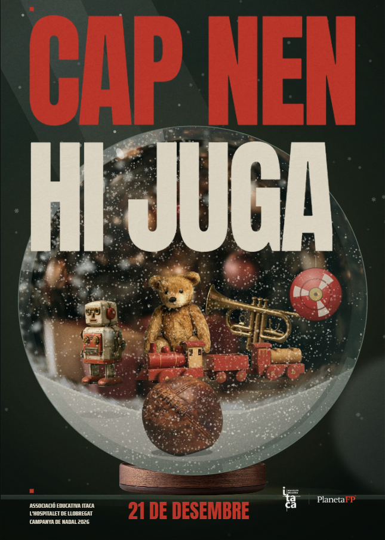

# Cap nen hi juga

Cartel digital interactivo para la campaña de Navidad de la **Associació Educativa Itaca** (L'Hospitalet de Llobregat), 21 de diciembre: juguetes para niños en riesgo de exclusión. Todo el texto del cartel está en catalán.
Actividad 0612 · Desarrollo web en entorno cliente.



## Concepto

Una bola de nieve olvidada, cubierta de escarcha, sobre un fondo casi negro. Dentro, la parte baja de un árbol de Navidad con sus bolas, luces y regalos, desenfocada como en una foto con poca profundidad de campo. Al pasar el cursor por encima, el cristal se limpia y aparecen seis juguetes, cada uno con su animación: una pelota de fútbol que rueda, un robot de cuerda que anda a saltos, un tren que avanza y retrocede, una trompeta que cuelga de una rama, un ioiò que sube y baja por su cordel y un osito. Si pasas por encima de un juguete ya destapado, se levanta, y **se puede coger con el ratón**: lo arrastras, lo lanzas y rebota contra el cristal, sin salir nunca de la bola. Si mueves el cursor rápido, la nieve se levanta: **quien agita la bola es el usuario**. Y el titular, que asegura que ningún niño juega con ella, tiembla al notarlo. La escarcha vuelve sola, poco a poco.

El titular, **CAP NEN HI JUGA**, es brutalista y es la composición entera: entre las dos líneas ocupan la mitad superior del cartel, y «HI JUGA» cruza la parte alta de la bola: dentro del cristal cambia de color con la escarcha, de verde casi negro a crema, para leerse siempre. Alrededor, microtipografía anclada a los márgenes, como en *The Iron Claw* (Utah State Film Club), el cartel *Brutalism / Boston City Hall* o *False Memory* (creaura.co). Abajo, en el footer, la entidad, la fecha en grande y los logos.

Detrás de la bola, sobre el muro, cae sin parar una nevada muy tenue, como lluvia.

Al fondo, apoyada en la misma repisa y desenfocada, hay otra bola igual de olvidada.

La dirección de arte es la de un cartel de cine:

- **Clave baja:** el cartel es verde abeto casi negro (`#16201A`) y el interior de la bola, la foto de un árbol oscuro iluminado solo por sus luces. Los juguetes, nítidos, son lo que más destaca dentro.
- Hay una sola fuente de luz, una ventana fuera de cuadro arriba a la izquierda. Su haz, muy tenue, barre el fondo despacio y el polvo brilla al cruzarlo.
- El calor (dorado y rojo) solo existe dentro de la bola.
- Según limpias la bola, emite un resplandor cálido sobre el fondo.
- El grano es fuerte y cae también sobre la tipografía: en brutalismo no es un acabado sutil, es parte del lenguaje.

Tres principios tomados de *The Moving Poster* (carteles de Michel Bütepage y Weplaydesign): movimiento continuo e independiente (los juguetes, el haz, el polvo y el anillo), un elemento que sigue al cursor (la bola se inclina hacia él) y una lente que deforma de verdad (la refracción del borde). Los juguetes son recortes fotográficos que se mueven enteros, como los objetos de Bütepage. La estética de collage no se copia.

## Archivos

| Archivo | Contenido |
|---|---|
| `index.html` | Estructura: capas del cartel, la bola, los juguetes (slots de imagen), los canvas, los textos y los logos |
| `style.css` | Paleta, degradados, posiciones, orden de capas y transiciones |
| `script.js` | Escalado, escarcha, nieve, escena, juguetes, color del titular, nevada de fondo, luz, efectos ambientales y eventos |
| `convertir_fotos.py` | Convierte a WebP (calidad 85) los PNG de `assets/` |

No se usa ningún framework. Para verlo, basta con abrir `index.html` en el navegador.

## Las interacciones

Todas se registran con `addEventListener()` sobre el contenedor `.bola`. Ninguna depende de `:hover` de CSS.

| # | Evento | Qué pasa |
|---|---|---|
| 1 | `mouseenter` | La escarcha baja un 4 % de opacidad (el cristal "nota" la mano) y el reescarchado va a ritmo lento |
| 2 | `mouseleave` | El reescarchado se acelera unas 13 veces y se apaga el hover de los juguetes |
| 3 | `mousemove` | Limpia la escarcha, detecta si el cursor está sobre un juguete destapado y detecta el agitado |
| 4 | `mousedown` | Coge el juguete destapado que hay bajo el cursor (ver *Coger los juguetes*) |
| 5 | `mouseup` (en `window`) | Lo suelta: sale con la velocidad que llevaba, frena y rebota contra el cristal |

Al limpiar, el color de «HI JUGA» se mueve con la escarcha que queda (ver *El titular brutalista*).

Además:

- `mousemove` en `document` alimenta los efectos ambientales: el polvo, el haz de luz, el brillo del cristal, la sombra, y la inclinación de la bola.
- `resize` en `window` reescala el cartel.

### Cómo funciona por dentro

- **El borrado** estampa una brocha a lo largo del trazo con `destination-out` sobre una máscara de cobertura; el canvas visible es la textura de escarcha recortada por esa máscara. La brocha es un degradado radial con calvas, así que deja vetas, como al limpiar un cristal con la mano. A los lados del trazo quedan fragmentos de hielo, en un canvas propio (`#humedad`), que se desvanecen cuando vuelve la escarcha.
- **Gotas de deshielo:** de vez en cuando, mientras limpias la mitad superior, se forma una gota (como mucho 3 a la vez). Resbala a tirones y abre un reguero en la escarcha.
- **El handler de `mousemove` no dibuja.** Solo guarda las coordenadas; todo el dibujo se hace dentro de `requestAnimationFrame`.
- **Las coordenadas del ratón** se miden contra `.escenario` y se dividen por la escala del cartel, porque el cartel de 848 × 1200 se escala completo para caber en la ventana. Después se resta la posición de la bola (39, 285). No se miden contra `.bola` porque, con la inclinación 3D, `getBoundingClientRect()` devolvería la caja ya rotada y el borrado aparecería desplazado del cursor.
- **El reescarchado es progresivo y nunca se retira solo:** lo que no se limpia se queda. Lo limpio se mantiene despejado 1,5 s y después vuelve a empañarse desde el borde hacia dentro, con grano, como el hielo. Si se ha limpiado toda la bola, se empaña toda. Vuelve poco a poco: con el ratón dentro, el centro tarda unos 30 s en cerrarse; fuera, 12 s.
- **La nieve tiene tres niveles de profundidad, cada uno en su canvas:** la lejana detrás de los juguetes (se posa en el suelo nevado de la foto), la media delante y la cercana por encima de la sombra interior, grande y desenfocada, como pegada al cristal. Cae sin parar, como si la bola tuviera vida dentro: cada copo que se posa se funde y vuelve a nacer arriba.
- **El cristal tiene volumen:** una sombra interior descentrada, un anillo que simula el grosor del vidrio, dos medias lunas asimétricas (luz directa y luz de rebote) y brillos especulares. Sobre la repisa, una cáustica cálida crece junto al resplandor según lo limpia que esté la bola.
- **Refracción en el borde:** al cargar, la escena interior (la foto y la duna) se compone en un canvas y se dibuja 28 veces en discos concéntricos, cada uno a una escala algo menor, para comprimirla contra el filo como una lente. Los copos se recolocan con la misma idea al dibujarse, sin tocar su posición física. Los juguetes y la escarcha no se refractan: los juguetes están lejos del filo y la escarcha está sobre el cristal, no dentro.
  - Los copos medianos y cercanos son estrellas de seis puntas que giran despacio. Se dibujan una sola vez como *sprites*, con 8 rotaciones pre-renderizadas.
  - Mover el cursor es como ladear la bola: la nieve deriva hacia ese lado, con inercia. Los copos cercanos se apartan del cursor.
  - Si la velocidad del cursor supera 1,2 px/ms, se desata una tormenta: los copos reciben un impulso y aparecen 150 copos de refuerzo, que se calman a los 2,5 s.
- **Movimiento reducido:** si el sistema tiene activado `prefers-reduced-motion`, la nieve queda quieta y no hay agitado, gotas, animación de los juguetes, barrido del haz ni temblor del titular, y la nevada de fondo se queda quieta (no desaparece). Los juguetes quedan quietos en su posición base y el hover sigue funcionando, porque la detección usa la base más un desplazamiento que vale cero. La escarcha se sigue limpiando y el color del titular la sigue.
- **El resplandor cálido** de detrás de la bola sube y baja entre el 8 % y el 63 % de opacidad según lo limpia que esté la bola en cada momento (la misma medición que mueve el color del titular).

### El interior: el árbol, difuminado

- **La foto** (`fondo.webp`, 1024 × 1024) es la parte baja de un árbol de Navidad decorado, con las bolas, las luces y los regalos ya incluidos. Las bolas van en la foto y no en SVG: bolas vectoriales planas sobre un árbol fotográfico chocarían de estilo. A cambio, no se balancean al agitar.
- **Difuminado:** al componer la escena se dibuja con `ctx.filter = 'blur(4px)'` (`DIFUMINADO_FONDO` en `script.js`), solo la foto. Los juguetes y la duna quedan nítidos delante, como con poca profundidad de campo, y el árbol no compite con ellos ni con el titular. Se hace una vez, al cargar, así que no cuesta nada durante la animación. Para más desenfoque basta con subir el número; a partir de 8 px las bolas del árbol se convierten en manchas.
- **Encaje:** escala 1,06, centrada en horizontal y desplazada para que el pie de los regalos de la foto (y = 950) caiga en y = 855 del cartel, justo detrás de donde se apoyan los juguetes. Así quedan delante de los regalos y sobre la nieve de la foto (constante `FONDO`). La foto llega a los cuatro bordes del canvas de la escena, así que la refracción no deja ningún aro vacío.
- **Suelo:** el montículo y el suelo vectoriales ya no están, porque la foto trae su suelo nevado. Queda la duna delantera, nítida, que tapa el borde inferior de la foto y en la que se apoyan el tren y el robot. Se ha pasado a un gris cálido para que case con la nieve de la foto.
- **La caja de regalo se ha retirado:** con los regalos de la foto al pie del árbol era redundante y se perdía entre ellos.

### El titular brutalista

- **Texto:** «CAP NEN / HI JUGA». Con `cap` delante del verbo, el IEC acepta la frase sin `no`, y es la forma más usada; además es más corta que «NINGÚ NO HI JUGA», lo que permite subir el cuerpo.
- **Tipografía:** Anton, de Google Fonts, con licencia OFL. Solo tiene un peso, y va en mayúsculas con el tracking cerrado (−0,03 em, siempre en `em` para que escale con el cuerpo). Gana a otras candidatas porque es estrecha: a igual ancho de línea cabe mucho más alta. Tiene Ú, À, È, É, Í, Ò, Ó y Ç: el catalán no obliga a cambiar de fuente.
- **Medida:** «CAP NEN» es la línea ancha y su tinta ocupa exactamente los 720 px de la zona segura (de 64 a 784). Medida en el navegador con `measureText`, a 248 px (lo que proponía el documento) mide 702, porque el tracking negativo también se come ancho; hacen falta 254,3 px. Como la tinta de la «C» empieza 7,2 px a la derecha del origen del texto, el bloque va en `left: 56.8px`, para que la tinta quede alineada con el margen. «HI JUGA» queda en bandera.
- **Letras más largas:** `transform: scaleY(1.1)` sobre todo el bloque, desde arriba. Estira las letras un 10 % sin cambiar el ancho (los 720 px se mantienen). Para que el bloque no crezca de más, la interlínea baja a 1,0 y el hueco entre las dos líneas queda en 37 px.
- **Posición:** `top: 24.4px`. Las mayúsculas de «CAP NEN» van de y = 40 a y = 282 y las de «HI JUGA», de y = 320 a y = 565, cruzando la parte alta de la bola. La trompeta oscila ahora ±34 px en vertical (antes ±46), para que su borde no suba de y = 578.
- **«CAP NEN» en rojo** (`#C4382C`), sobre el fondo oscuro: ahí se lee bien siempre.
- **«HI JUGA» cambia de color con la escarcha.** Medido sobre la build, la escarcha es `#C6C9BE` y el árbol destapado `#664435`: el crema daba 1,27:1 sobre la escarcha (invisible) y 6,50:1 sobre el árbol. Ningún color plano aguanta los dos, así que el color se mueve con el porcentaje de escarcha (`colorTitular()`): **verde casi negro `#16201A` con la bola empañada** (9,95:1 sobre la escarcha) y **crema `#E8DFCF` con la bola limpia** (6,50:1 sobre el árbol), con una mezcla lineal entre los dos. El porcentaje se mide ~5 veces por segundo y una transición de 0,3 s funde el color entre medida y medida (la variable `--color-escarcha` está registrada con `@property` como `<color>`: sin registrar, una variable no se anima y saltaría de golpe).
- **Solo dentro de la bola.** La parte alta de la H y de la I cae fuera del cristal, sobre el muro, que también es `#16201A`: ahí el verde desaparecería. Por eso el color de cada palabra es un degradado radial con la forma exacta de la bola, recortado a la letra con `background-clip: text`: dentro del cristal, el color de la escarcha; fuera, crema siempre. Con la bola empañada, el borde del cristal corta las letras en dos tonos. `prepararTitular()` calcula dónde cae el centro de la bola respecto a cada palabra (con `offsetLeft`/`offsetTop`, que no cambian con el temblor ni con el escalado del cartel); la `y` y el radio vertical se dividen por el `scaleY` del titular, que se lee del propio CSS. Sin modos de fusión: `difference` embarraba el titular.
- **La medición** (`medirEscarcha()`): contar los 590 000 píxeles de la escarcha cada fotograma sería carísimo. Se reduce la máscara a 64 × 64, se suma el alfa (el reescalado ya promedia) y se hace ~5 veces por segundo. Se normaliza contra `sumaInicial`, la lectura real con la escarcha completa, así que arranca exactamente en 100. Solo cuentan los píxeles del círculo: las esquinas de la máscara, fuera del cristal, no se pueden limpiar nunca. La misma medición mueve el resplandor y la cáustica.
- **`pointer-events: none`:** el titular no tapa los juguetes, pero su caja es rectangular e invade la bola; sin esa línea, la escarcha dejaría de limpiarse ahí sin dar ningún error.
- **Tiembla al agitar.** Cada palabra va en su `.palabra` (`display: inline-block`, sin el cual `transform` no se aplica). Cuando la tormenta de la nieve pasa de 1,35, `temblarTitular()` desplaza cada palabra al azar, como mucho ±2,75 px. Si se moviera el bloque entero parecería un error de renderizado. Sube y baja con la misma variable `tormenta` que acelera la nieve.

### Microtipografía y logotipos

La otra mitad del aspecto brutalista: bloques anclados a los márgenes, en Saira Condensed 700 y mayúsculas, con `pointer-events: none` en toda la capa.

| Bloque | Dónde | Contenido |
|---|---|---|
| Footer, a la izquierda | Sobre el frente de la repisa, x = 64 | «Associació Educativa Itaca · L'Hospitalet de Llobregat · Campanya de Nadal 2026», en crema a 13 px |
| Footer, en el centro | Centrada entre la entidad y los logos | **«21 DE DESEMBRE»: la fecha**, en Anton a 44 px y en el rojo del titular |
| Footer, a la derecha | x = 784, y = 1080 | Los dos logotipos |

Dos marcadores rojos de 9 × 9 px en x = 64, arriba y abajo, rematan el lenguaje.

- **La fecha es obligatoria y solo aparece en el footer**, así que va grande: en Anton, como el titular, y en su rojo, para que se vea sin competir con él (44 px frente a 254). Sus mayúsculas quedan a la altura del bloque de la entidad.
- **Debajo del titular no hay texto:** la bola queda limpia, solo con los juguetes.
- El footer empieza en y = 1114: más arriba lo cruzaría el filo de la repisa, que está en y = 1100 porque ahí se apoya la base de la bola.
- **La entidad es una asociación, no una fundación:** «Associació Educativa Itaca» en el footer, el `<title>` y el `alt`.

**Los logotipos:** Itaca primero (la entidad de la campaña) y PlanetaFP después (el centro que la firma), en fila, alineados a la derecha en x = 784 y separados por un filete vertical de 1 px con 18 px de aire a cada lado, para que no se lean como una sola marca. La bola acaba en y = 1055, así que no se apoyan en el cristal.

- **El alto manda, nunca el ancho**, pero igualar el alto no iguala el peso: el de Itaca es un bloque vertical y compacto, y PlanetaFP un logotipo ancho. A 34 px los dos, PlanetaFP se imponía y el texto pequeño de Itaca no se leía. Ajustados a ojo: Itaca a 56 px y PlanetaFP a 24 px.
- **Colores oficiales, sin filtros CSS.** El de Itaca llega en su versión monocroma blanca. El de PlanetaFP lleva «Planeta» en negro, que sobre el fondo casi negro desaparecía, así que se usa una versión en negativo (`logoFP-negatiu.png`): «Planeta» en blanco y «FP» en su rojo exacto, sin tocar. El original sigue en `assets/logoFP.png`. Si el centro tiene su versión oficial en negativo, hay que sustituirla.
- Van en la capa 20, por encima de la bola y por debajo del grano: así la textura cae también sobre las marcas y no parecen una pegatina puesta al final.

### Los seis juguetes y su animación

Cada foto se encaja **sin deformar**: el slot mide lo que mide el contenido de la foto a su escala. Son grandes: **el oso** (149 × 185) va justo bajo el titular, y **el tren** (372 × 100, un 20 % más que en la v4) cruza la bola por el centro para que se lea largo; la pelota, el robot y el ioiò van al tamaño de la v4 y la trompeta, al 92 %.

**La bola está llena.** Debajo del titular y dentro del cristal quedan unos 236 000 px² útiles, y a este tamaño los seis juguetes ocupan más del 70 %. Se probó con un script: con aire entre ellos solo caben siendo bastante más pequeños, y ni quitando uno se gana sitio suficiente, porque lo que limita es la franja de abajo, que se estrecha con la curva del cristal. Se eligió el tamaño: los juguetes quedan muy juntos y se rozan (hasta ~29 px de solape entre cajas en reposo; como las fotos tienen las esquinas transparentes, a la vista se pisan menos), y al moverse se cruzan a ratos, como en una bola de nieve de verdad.

Dos bandas: **arriba**, el oso, la trompeta y el ioiò, que flotan o cuelgan; **abajo**, en el suelo, el robot, el tren y, delante de todo, la pelota. El oso queda justo detrás del tren, como si fuera montado en él. Las posiciones se buscaron con un script que reparte el solape lo más igual posible, con tres condiciones: ninguno se sale del cristal, ninguno sube por encima de y = 572 (la tinta de «HI JUGA» acaba en 565) y ninguno queda bajo el bloque de texto de la izquierda. Orden de pintado, de atrás adelante: ós → trompeta → ioiò → robot → tren → pilota.

La base de la animación está medida sobre el cartel *Bachelor Presentation* de **Michel Bütepage** (visto en *The Moving Poster*): **dos frecuencias por parámetro.** Cada valor es la suma de dos senos (`osc()`): uno lento y amplio, y otro rápido y pequeño, con periodos que no son múltiplos entre sí. Con un solo seno sería un péndulo y el bucle se notaría a los tres segundos; con dos, nunca se repite igual. Encima, cada juguete tiene su animación propia (`ANIMACIONES` en `script.js`).

| Juguete | Medida | Base (cartel) | Animación |
|---|---|---|---|
| Osito | 149 × 185 | (377, 694) | Deriva corta: ±14 px, ±8 px, ±7° |
| Pelota de fútbol | 174 × 173 | (427, 915) | **Rueda** ±41 px. El giro sale del recorrido: ángulo = distancia / radio (87 px, el real), ±27°. Si se pusiera por su cuenta, parecería que patina |
| Trompeta | 213 × 153 | (549, 698) | Cuelga de una rama: solo deriva, ±22 px, ±12 px, ±12° |
| Tren | 372 × 100 | (487, 807) | **Avanza y retrocede** ±18 px (al ser largo, con poco recorrido ya se nota que anda), traquetea (±2,5 px) y se inclina con la velocidad: se encabrita al arrancar y se hunde al frenar |
| Robot | 99 × 206 | (275, 815) | **Anda a saltos:** ocho pasos adelante y ocho atrás, de 8 en 8 px, uno cada 625 ms. La x cambia de golpe, sin interpolar; solo el balanceo (±7°, sobre los pies) y el alzarse al pisar son continuos |
| Ioiò | 122 × 122 | (689, 649) | **Sube y baja** 60 px por su cordel, tres vueltas por ciclo. Baja más rápido de lo que sube, y `Math.pow(·, 0.7)` lo frena al llegar abajo, como uno de verdad |

- **El ioiò** no tiene foto: es un SVG con degradados para darle volumen y tres franjas asimétricas, porque un disco liso girando parece quieto. El cordel es una `<line>` SVG aparte, que no gira con él: su extremo superior está fijo bajo el titular y el inferior sigue al eje en cada fotograma.
- **Ningún periodo es igual ni múltiplo de otro** (×1 y ×2 con un 3 % de tolerancia, ×3 exacto), comprobado con un script. Si dos coincidieran, esos dos juguetes se sincronizarían y el conjunto parecería un salvapantallas. Los valores del documento chocaban entre sí: el giro del ioiò y la y de la trompeta iban los dos a 4900 ms, el ciclo del ioiò y la y rápida de la pelota a 1900, la x rápida del oso (3400) era el doble exacto de la y rápida de la trompeta (1700) y la y de la pelota, 5700 = 3 × 1900. Se han movido lo mínimo, nunca más de un 8 %. Al añadir un objeto hay que volver a comprobarlo.
- **Ninguno se sale del cristal.** La regla vieja (distancia + deriva + media diagonal ≤ 340) era demasiado conservadora: suponía que la esquina más lejana del objeto apunta siempre hacia fuera, y en un objeto ancho y plano como el tren casi nunca es así. Ahora se comprueban las cuatro esquinas reales de cada slot, ya giradas (la pelota y el ioiò, que son redondos, como discos), a lo largo de la animación y también con la subida del hover. Límite: 340 px del centro (45 de aire respecto al borde). La comprobación se hizo con un script de desarrollo que no forma parte del proyecto, así que la consola queda limpia.
- **La banda de arriba y el titular:** el oso, la trompeta y el ioiò están justo debajo de «HI JUGA». En el peor momento de su ciclo, y con la subida del hover, ninguno sube de y = 572. Por eso el oso deriva tan poco en vertical (±8 px). Si hiciera falta, se baja la amplitud vertical, no la base.
- **Dos transformaciones anidadas:** el div del juguete (`.joguina`) lleva la animación desde JS, sin transición (encima de un movimiento continuo, una transición lo retrasaría y lo haría pastoso; en el robot, además, le quitaría los saltos). Dentro, `.joguina-hover` lleva la imagen y la reacción al hover: JS solo pone la clase `.activo` y el CSS sube el juguete 14 px y lo gira 2° con una transición de 220 ms. La imagen se pasa al div interior con variables CSS (`--img`, `--tam`, `--pos`).
- **El tren se inclina con la derivada exacta de `osc()`** (`velocidadOsc()`), no restando dos fotogramas: no depende del intervalo entre fotogramas, así que no tiembla, y no hay un valor anterior que inicializar, así que el primer fotograma no da un giro absurdo.
- **La detección usa la posición viva:** base más desplazamiento. Con hasta ±41 px de recorrido (la pelota), la posición base dejaría la zona sensible fuera del objeto. La zona es una elipse por juguete, porque el tren es 3,7 veces más largo que alto y un círculo no lo cubriría. No incluye la subida del hover: si la zona subiera con el juguete, dejaría de estar bajo el cursor, bajaría y volvería a subir, en bucle. Solo se activa si ese píxel de la escarcha está limpio (alfa < 60, nunca `=== 0`).
- **Con dos juguetes solapados bajo el cursor, gana el más cercano** (`jugueteBajoCursor()`), medido como distancia relativa a su elipse, para que uno grande no gane solo por serlo. Solo uno se activa a la vez.
- **Sombras de contacto:** solo los que están en el suelo (pelota, robot y tren). El oso y el ioiò flotan y la trompeta cuelga: ninguno lleva. **Nunca rotan:** una sombra sobre el suelo no gira con la pieza. Cuando el juguete se separa del suelo, se ensanchan y se aclaran. La pelota, el robot y el tren, que se desplazan por el suelo, se llevan la sombra entera. (Con media amplitud, la sombra de la pelota se quedaba atrás al rodar.)
- **Cómo ajustarlo:** primero la rotación (es el 70 % del efecto), después la amplitud de traslación (si algo se sale del cristal, se baja la amplitud, no se mueve la base) y los periodos al final, de uno en uno.

### Coger los juguetes

Con el cursor sobre un juguete destapado, la mano se abre (`cursor: grab`). Al pulsar, se coge (`grabbing`): se levanta, crece un 7 %, gana una sombra que lo separa de la escena y pasa al frente. Sigue al cursor con un pelín de retraso, para que pese, y se ladea hacia donde va según la velocidad, como algo que cuelga de la mano. Al soltarlo sale con la velocidad que llevaba, frena por rozamiento y rebota contra el cristal. Se queda donde lo dejas y, poco a poco, retoma su animación desde ahí.

- **Nunca sale de la bola** (`cabeEnLaBola()`): el límite se calcula con lo que ocupa de verdad cada juguete (las cuatro esquinas de su caja o, en la pelota y el ioiò, un disco), más lo que su animación lo aleja de la base hacia cada lado, para que tampoco se salga cuando vuelva a moverse solo. Si el cursor sale de la bola arrastrando, el juguete se queda pegado al cristal por dentro.
- **Resbala por la pared en vez de quedarse pegado** (`moverDentro()`): si el punto al que va no cabe, se acerca al centro de la bola por bisección hasta que cabe.
- **El titular hace de techo:** el cristal sigue por detrás de «HI JUGA», y un juguete lanzado hacia arriba se quedaba escondido tras las letras. No sube por encima de y = 572 y rebota contra él.
- **Sin saltos al cogerlo:** su animación se congela donde está (el desplazamiento pasa a la base) y el giro que tenía se endereza solo. Al soltarlo, la animación vuelve en medio segundo.
- **Al frente:** al cogerlo pasa a ser el último juguete del DOM, así al soltarlo se queda delante de los demás.
- Arrastrar deprisa también agita la nieve y limpia la escarcha por donde pasa, como cualquier movimiento del ratón.
- El `mouseup` se escucha en `window`, no en la bola: si el cursor sale arrastrando, también lo suelta. Y al cambiar de ventana (`blur`) se suelta solo.
- La sombra de los juguetes del suelo se queda en el suelo cuando los levantas, y se aclara con la altura. El cordel del ioiò lo sigue.
- Con `prefers-reduced-motion` se puede coger y soltar igual, pero sin inercia: se queda exactamente donde lo dejas.

### Fondo y atmósfera

De atrás adelante:

1. **Fondo** verde abeto casi negro, con un degradado direccional y una viñeta suave.
2. **Haz de luz volumétrico, muy atenuado** (35 %): dos bandas con degradado que se desvanece hacia abajo. A plena intensidad competía con el titular; ahora queda solo como un rastro de luz donde el polvo puede encenderse. Una animación CSS de 22 s lo hace oscilar ±3,5° alrededor de un pivote fuera del lienzo, donde estaría la ventana. El parallax del cursor (±12 px) va en un grupo aparte (`#haz-parallax`), porque la animación CSS anularía el atributo `transform` si fueran el mismo elemento. El giro necesita `transform-box: fill-box` para que el pivote quede donde debe.
3. **Repisa:** un frente oscuro, un canto de 9 px que recibe la luz y la línea del borde, así que la bola deja de flotar.
4. **Segunda bola al fondo:** abajo a la derecha, recortada por el borde del lienzo, muy desenfocada y atenuada, para que se lea como profundidad de campo.
5. **Polvo:** 26 motas que derivan solas. `factorHaz()` calcula lo cerca que está cada una de la línea central del haz. Para ello deshace el giro del barrido (leído de la propia animación con `getAnimations()`, así que siempre van a la par) y el parallax. Las motas de dentro del haz brillan y crecen; las de fuera casi no se ven.

Por delante van el resplandor, la cáustica, las sombras y la bola; el polvo flota en el aire de la habitación, no dentro del cristal.

### La nevada de fondo

Detrás de todo, sobre el muro, caen 90 copos como lluvia: constantes, casi rectos y con un poco de viento (`pluja()`, en el lienzo `#neu-fons`). Es fondo y es discreta a propósito: copos pequeños (5–13 px) y tenues (10–30 % de opacidad), que además apaga la viñeta general.

- **Profundidad sin paralaje:** cada copo tiene una profundidad que decide a la vez su tamaño, su velocidad y su opacidad. Los cercanos son más grandes, más rápidos y algo más visibles.
- El copo es el mismo *sprite* de seis puntas que la nieve de dentro, con 8 rotaciones pre-renderizadas, así que girar no cuesta nada.
- **Barata:** los que caen detrás de la bola ni se dibujan, porque la bola los tapa.
- Con `prefers-reduced-motion` se pinta una vez y se queda quieta.
- Sustituye al anillo de copos en perspectiva de la versión anterior. La nieve de dentro de la bola sigue igual.

### La bola se inclina hacia el cursor

Hasta 3°: a partir de 5°, el círculo se delataría como elipse.

- **Qué se inclina:** `.bola-inclinable`, un envoltorio con todas las capas visuales. `.bola` no se mueve nunca, porque recibe los eventos y lleva el `clip-path`.
- **Perspectiva:** va dentro del propio `transform`, porque `perspective` en `.escenario` no llegaría hasta un nieto.
- **Compensación del borde:** con perspectiva, el lado que se aleja encoge unos 5 px y dejaría ver una media luna sin escarcha junto al borde. Para evitarlo, `inclinarBola()` añade la escala justa para compensarlo: 1 en reposo y alrededor de 1,017 a tope.

## Orden de capas

```
 0. Nevada de fondo
 1. Fondo casi negro · haz atenuado · repisa · bola de fondo · polvo
 2. Viñeta general
 3. Resplandor cálido · 4. cáustica y sombras sobre la repisa
 5. Base · 6. LA BOLA (inclinable)
      foto del árbol (difuminada) → duna → nieve lejana → sombras de contacto y cordel
      → juguetes (osito, trompeta, ioiò, robot, tren, pelota) → nieve → cristal → escarcha
 7. Borde exterior del cristal
20. TITULAR · microtipografía · LOS DOS LOGOS   ← pointer-events: none
21. Papel pintado (0,22) · 22. ruido (0,14)
```

Todo el texto y los logos van por encima de la bola y por debajo de las texturas, para que el grano caiga también sobre la tipografía y las marcas. Si los textos de 11 px se ensucian, el grano se baja a 0,11, nunca por debajo de 0,09.

## Requisitos del enunciado

| Requisito | Cómo se cumple |
|---|---|
| Funciones propias | `limpiarEscarcha()`, `estaDestapado()`, `reescarchar()`, `agitar()`, `sumaAlfa()`, `medirEscarcha()`, `prepararTitular()`, `colorTitular()`, `ajustarEscala()`, `osc()`, `velocidadOsc()`, `animar()`, `jugueteBajoCursor()`, `cabeEnLaBola()`, `moverDentro()`, `coger()`, `soltar()`, `pluja()`, `cargarEscena()`, `factorHaz()`, `inclinarBola()`, `temblarTitular()`, entre otras |
| Captura del estado final | Se limpia la bola entera («HI JUGA» queda en crema) y se captura antes de que pase 1,5 s sin mover el ratón |
| Al menos 2 propiedades visuales modificadas desde JS | `opacity` del canvas, del resplandor, de la cáustica y de las sombras de contacto; `transform` de juguetes, sombras, la bola inclinable y cada palabra del titular; `--color-escarcha` y el degradado de «HI JUGA»; atributos SVG del polvo (`opacity`, `r`, posición), el haz, el brillo, la sombra y el cordel del ioiò |
| Sin errores en consola | Comprobado en Chrome |
| Fecha, tema, mensaje y *branding* | La fecha, «21 DE DESEMBRE», grande en el footer; titular, microtipografía (entidad) y los logos de la Associació Educativa Itaca y PlanetaFP |
| Idioma | `lang="ca"`; `<title>`, `alt` y `aria-label` en catalán |
| Accesibilidad | `prefers-reduced-motion` deja todo quieto y el hover sigue funcionando |

## Imágenes (`assets/`)

Las fotos llegan en PNG y se convierten a WebP con `convertir_fotos.py` (calidad 85). El cartel usa las WebP porque pesan mucho menos: `fondo` pasa de 1,7 MB a 172 KB.

| Imagen | Dónde va | Cómo se conecta |
|---|---|---|
| `fondo` (la parte baja del árbol) | Canvas de la escena, difuminada, y después se refracta | `FONDO` y `DIFUMINADO_FONDO` en `script.js` |
| `trompeta`, `robot`, `juguete-oso`, `pelota`, `tren`, `base-madera` | Fondo de su div (slot) | `style.css` |
| `papel-pintado`, `ruido` | Capas de textura con `mix-blend-mode` | `style.css` |
| `logoItaca` (monocromo blanco) y `logoFP-negatiu` (PlanetaFP en negativo, generado a partir de `logoFP`) | Abajo a la derecha, como `` | `index.html` (`.logos`) |

- **Encaje de los juguetes:** todas las fotos traen margen transparente. `background-size` y `background-position` están calculados sobre el contenido real de cada imagen, medido sobre su canal alfa, para que el contenido ocupe el slot exacto. Si se sustituye una imagen, hay que recalcularlo (las medidas están en el comentario de `style.css`).
- **Ya no se usan:** `juguete-caja` (redundante con los regalos de la foto) y `peonza` (fuera de la lista). Siguen en `assets/` por si se recuperan.
- Para ver los marcos de los slots al ajustar posiciones, añade `class="ver-slots"` al `<body>`.

## Créditos

Técnicas adaptadas a JavaScript sin frameworks:

- **Escarcha** (brocha con calvas, cristales en el borde del trazo, reempañado por tandas y gotas que resbalan): *Fogged Glass*, de **Aakash Mehra** ([21st.dev](https://21st.dev/community/components?q=rain+window&preview=%2F%40aakashmehra%2Fcomponents%2Ffoggy-window-wipe) · aakashmehra.com).
- **Motor de nieve** (profundidad, viento, repulsión del cursor, tormenta y *sprites* pre-renderizados): pen de **iamjamie** en [CodePen](https://codepen.io/iamjamie/pen/emvXjjw), que a su vez acredita a Loktar, pimskie, Neave y Tiffany Rayside.
- **Forma del copo** (estrella de seis puntas): pen de **iautomation** en [CodePen](https://codepen.io/iautomation/pen/VYexBz).

Inspiración para el fondo, la deriva de los objetos y las animaciones: *The Moving Poster*, de **Michel Bütepage** y **Weplaydesign**.

Tipografías: **Anton** (titular y fecha) y **Saira Condensed** (microtipografía), ambas de Google Fonts con licencia OFL y cargadas en una sola petición.

Referencias de estilo para el titular y la microtipografía: *The Iron Claw* (Utah State Film Club), *Brutalism / Boston City Hall* y *False Memory* (creaura.co).

## Pendiente

- [ ] Sustituir `logoFP-negatiu.png` por la versión oficial en negativo de PlanetaFP, si el centro la tiene
- [ ] Opcional: una foto del ioiò en vez del SVG, para que case con los demás juguetes (habría que recalcular su slot)
- [ ] Opcional: parallax muy leve de la foto del árbol (±6 px, contrario al cursor)
- [ ] Opcional: refractar también el fondo (el muro y el haz, comprimidos e invertidos) en el anillo del cristal, como la lupa de Bütepage. Se haría con `refractarEscena()` muestreando el fondo. El cartel funciona sin ello
