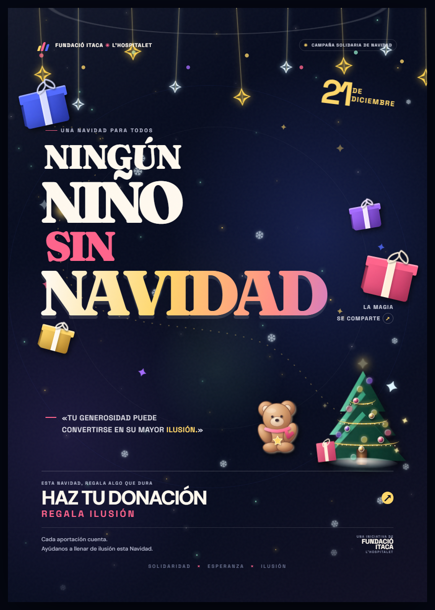

# Ningún niño sin Navidad

Cartel digital interactivo para la campaña solidaria de Navidad de Fundació ITACA L'Hospitalet. La pieza invita a colaborar para que ningún niño se quede sin celebrar estas fiestas.

## Captura final

## Concepto

Una composición nocturna de estilo editorial combina tipografía de gran formato, regalos flotantes, luces y copos de nieve. La paleta azul noche, coral, violeta y dorado transmite calidez y esperanza. El árbol navideño ampliado y el oso con volumen añaden profundidad a la escena.

## Interacciones

- Los regalos reaccionan al cursor y se abren al hacer clic, pulsar Enter o usar la barra espaciadora.
- El árbol permite encender y apagar sus luces.
- Al activar el oso, este baila.
- El movimiento del cursor crea un efecto de paralaje y una estela de destellos.
- Partículas y nieve animadas ambientan el cartel; se respeta la preferencia del sistema por reducir el movimiento.

## Tecnologías

- HTML5 para la estructura del cartel.
- CSS3 para el diseño, la adaptación a pantalla, las animaciones y el efecto de profundidad.
- JavaScript sin dependencias para las interacciones y los efectos ambientales.
- Google Fonts para Space Grotesk, DM Sans y Fraunces, con alternativas locales.

## Archivos

- `index.html`: contenido y estructura.
- `style.css`: composición visual y animaciones.
- `main.js`: interacciones, paralaje, partículas y nieve.
- `poster-final.png`: captura final del cartel.

## Cómo abrirlo

Abre `index.html` en un navegador moderno. No requiere servidor ni instalación. Se necesita conexión a Internet para descargar las fuentes de Google; sin conexión se usarán fuentes alternativas.

El cartel conserva la proporción **848:1200** y se adapta al tamaño de la ventana.