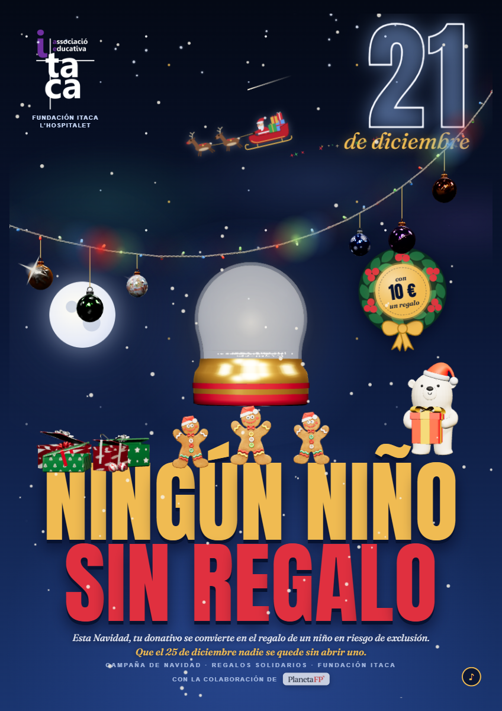

# The Interactive Poster · 21 de diciembre · Fundación ITACA

Actividad 0612 · Desarrollo web en entorno cliente.

Cartel digital interactivo (848 × 1200 px) de sensibilización para la **Fundación ITACA**: una campaña de donativos para comprar regalos de Navidad a niños en riesgo de exclusión. Está hecho con HTML, CSS y JavaScript, con una escena 3D creada con [Three.js](https://threejs.org/) a partir de modelos `.glb` y nieve con física real gracias a [matter.js](https://brm.io/matter-js/).

## Concepto

**«Ningún niño sin regalo.»** Es una noche de Navidad en la que está nevando. El azul de la noche es el fondo de toda la página: el cartel no tiene bordes y se funde con ella. Arriba, el logotipo de Itaca y la fecha, con un «21» gigante dibujado solo con su contorno. En el cielo, la luna, una aurora suave, una guirnalda de luces con bolas colgando de su cable, una bola de nieve y una corona de acebo con un sello dorado que recuerda la cifra del donativo: **con 10 € un regalo**.

El título es el protagonista: **«NINGÚN NIÑO SIN REGALO»** en letras gigantes (tipografía *Anton*), dorado y rojo. Sobre él están de pie los tres niños, representados por galletas de jengibre (Leo, Aina y Pau, cada uno con su deseo), los regalos y un oso polar con una caja sorpresa. Debajo, el mensaje de sensibilización.

La nieve cae de verdad. Con **matter.js**, cada copo es un cuerpo físico y cada letra del título es un cuerpo estático con la forma de su glifo (medida con canvas), así que la nieve **se va posando sobre las letras**. Los montones no crecen para siempre: cuando una letra acumula demasiada nieve, o de vez en cuando al azar, el montón **se derrumba**, resbala por los bordes de la letra y cae a la línea de abajo o al suelo, donde se amontona.

El cursor actúa como la persona que dona: ilumina la escena con una luz cálida, aparta la nieve, mece las bolas y despierta a los objetos.

Contenido obligatorio: la fecha (**21 de diciembre**), el tema (Fundación ITACA, regalos solidarios), el mensaje de sensibilización, la composición visual, los elementos interactivos y el branding de la entidad (logotipo arriba a la izquierda). En el pie aparece la empresa colaboradora, **PlanetaFP** («Con la colaboración de»).

## Las tres interacciones principales

1. **Sello del donativo (`mouseenter` / `mouseleave` / `click`).** Al pasar el ratón por el sello «con 10 €», crece, gira, cambia de dorado a rojo y los regalos 3D abren la tapa. Al salir, todo vuelve a su estado. Al hacer clic, estalla confeti, los regalos saltan y suena una melodía de campanillas.
2. **Título y nieve con física (`mouseenter` / `mouseleave` / `mousemove`).** Al entrar en el título, las letras saltan una tras otra y se sacuden la nieve acumulada. El cursor aparta los copos y empuja la nieve posada sobre las letras (matter.js).
3. **Escena 3D que sigue al cursor (`mousemove` / `click`).** Con *raycasting* se detecta el objeto 3D bajo el ratón: crece y muestra su etiqueta (el deseo de cada niño). Los objetos miran al cursor, una luz cálida lo sigue y, al hacer clic, la bola de nieve se agita, las bolas suenan y los niños saltan.

## Eventos e interacciones

| Evento | Elemento | Qué ocurre |
| --- | --- | --- |
| **`mouseenter`** | Sello «con 10 €» de la corona | El sello crece, gira y pasa de dorado a rojo con un halo; los regalos 3D abren la tapa, los niños se asoman y suena una campanilla. |
| **`mouseleave`** | Sello | El sello y los regalos vuelven a su estado inicial. |
| **`mouseenter`** / **`mouseleave`** | Título «NINGÚN NIÑO SIN REGALO» | Las letras saltan una tras otra en dorado y blanco y se sacuden la nieve acumulada encima; al salir, vuelven a su sitio. |
| **`mouseenter`** / **`mouseleave`** | Logotipo de Itaca | El logotipo crece, gira un poco y se ilumina con un halo dorado; al salir, se restaura. |
| **`mousemove`** | Cartel | Detecta con *raycasting* el objeto 3D bajo el cursor (crece y muestra su etiqueta, por ejemplo el deseo de cada niño). Los objetos giran hacia el cursor, la cámara se desplaza, una luz cálida sigue al ratón, el cursor empuja las bolas colgantes, aparta los copos que caen y la nieve posada sobre el título (matter.js) y deja destellos, y la fecha y la luna se mueven en capas (paralaje). |
| `mouseleave` | Cartel | Todo vuelve suavemente a su posición de reposo. |
| `click` | Sello | Estalla confeti, los regalos saltan y los niños lo celebran con una melodía de campanillas. |
| `click` | Corona | El lazo da un salto y suenan dos campanillas. |
| `click` | Cielo o nieve | Un estallido de copos y destellos; la nieve posada cercana sale despedida. |
| `click` | Objetos 3D | La bola de nieve se agita, las luces cambian de ritmo, las bolas giran, brillan y suenan, y los niños saltan. |
| `mouseenter` / `click` | Cajas de regalo | Al pasar el cursor, las tapas se abren y las cajas giran; al hacer clic, saltan y las tapas se abren y se cierran varias veces. En reposo, cada caja se abre y se cierra a su ritmo. |
| `mouseenter` / `click` | Caja sorpresa | Al pasar el cursor, la tapa se entreabre y el oso polar se asoma; al hacer clic, la caja gira, la tapa se abre y el oso sale de un salto. |
| `mouseenter` / `mouseleave` | Trineo de Papá Noel | El trineo, que cruza el cielo con sus renos dejando una estela de destellos, se frena y brilla en dorado; al salir, recupera su velocidad. |
| `click` | Trineo de Papá Noel | Da un salto, Papá Noel dice «¡Jo, jo, jo!», suelta confeti de regalos y suenan cascabeles. |
| `click` | Botón de sonido (♪) | Activa o desactiva los sonidos del cartel. |
| `keydown` (Espacio) | Ventana | Agita la bola de nieve. |
| `resize` | Ventana | `fitPosterToWindow()` escala el cartel sin cambiar la composición. |

Todos los eventos se registran con `addEventListener()`. JavaScript modifica dinámicamente, entre otras, las propiedades `transform`, `color`, `background-color`, `box-shadow`, `opacity` y `filter`, y la posición, rotación, escala y brillo de los objetos 3D.

Funciones propias principales: `highlightSeal()`, `resetSeal()`, `celebrateSeal()`, `setupSnowPhysics()`, `addLetterBodies()`, `updateAvalanches()`, `collapseSnow()`, `pushSnow()`, `shakeSnowOffTitle()`, `confettiBurst()`, `celebrateTitle()`, `restTitle()`, `highlightBrand()`, `resetBrand()`, `handlePosterMove()`, `pickObject()`, `handleObjectClick()`, `createOrnament()`, `setupGiftBoxes()`, `setupSurpriseBox()` y `fitPosterToWindow()`.

## Ejecución

Los modelos `.glb` y los módulos de JavaScript no se cargan abriendo el archivo directamente (`file://`). Hay que usar un servidor local:

- **Live Server** en VS Code: clic derecho sobre `index.html` → *Open with Live Server*.
- O desde la carpeta del proyecto: `python -m http.server` y abrir `http://localhost:8000`.

Se necesita conexión a Internet para cargar Three.js, matter.js y las tipografías desde el CDN.

## Archivos

- `index.html`: estructura y contenido.
- `style.css`: diseño y transiciones.
- `main.js`: escena 3D, nieve con física (matter.js) e interacciones.
- `img/logo-itaca-blanco.png`: logotipo de Itaca en versión transparente para fondo oscuro (letras blancas, morado original).
- `img/logo-itaca.png`: logotipo original.
- `img/logo-planetafp.png`: logotipo de PlanetaFP, empresa colaboradora.
- `3D/`: modelos `.glb` (luces, bolas de Navidad, bola de nieve, regalos, oso polar y galletas de jengibre).
- `captura.png`: captura del cartel completo.
