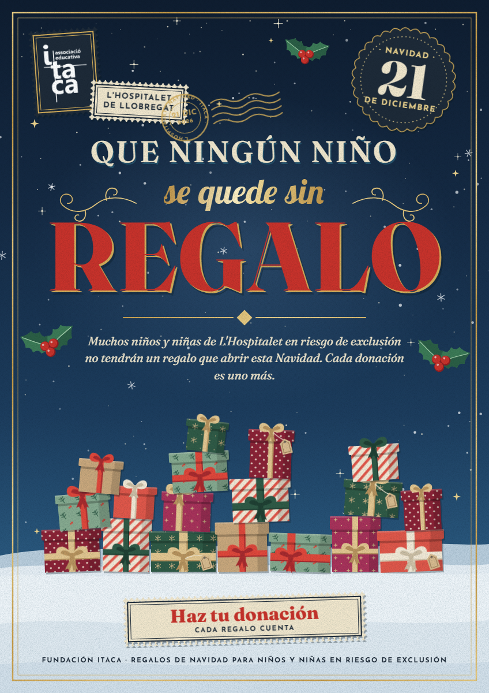

# Que ningún niño se quede sin regalo · 21 de diciembre · Fundación ITACA

Cartel digital interactivo (848 × 1200 px) para la actividad *The Interactive Poster* de 0612 · Desarrollo web en entorno cliente.

## Concepto

El 21 de diciembre la Fundación ITACA reparte regalos de Navidad a niños y niñas de L'Hospitalet en riesgo de exclusión.

El cartel tiene dos caras:

- **En la web**, la pila de regalos empieza vacía: solo hay huecos punteados dorados, los regalos que faltan. Al pasar el cursor por cada hueco, su regalo cae desde arriba y encaja en su sitio. Cada gesto es un regalo más.
- **El estado final**, con todos los regalos en su sitio, es el cartel impreso. No tiene botones ni contadores: titular, fecha, mensaje, la pila completa, la llamada «Haz tu donación» y la marca de Itaca.

La estética es la de un libro navideño antiguo:
- Cielo de noche navideña con estrellas que titilan, suelo nevado bajo los regalos, textura de papel y un marco dorado doble.
- Volutas y estrellas doradas, y tres ramas de acebo ilustradas en estilo plano.
- Un titular que mezcla mayúsculas crema, cursiva dorada en Lobster Two y un «REGALO» enorme en rojo con filete dorado.
- El logo de Itaca va en un sello de correos, con un matasellos de L'Hospitalet del 21 de diciembre, y la fecha en un medallón festoneado.
- Los regalos son ilustraciones vectoriales que dibuja `giftSVG()`:
  - Caja con tapa que sobresale, cara lateral en sombra y sombra bajo la tapa.
  - Papeles estampados, con patrones SVG de lunares, ramitas, copos, estrellas y rayas.
  - Cinta simple o en cruz y lazo con dos lazadas y cintas colgando.
  - Algunos llevan etiqueta de kraft con cordel.
- La pila está compuesta a mano para que el cartel impreso quede equilibrado.

## Eventos de JavaScript

Todos se registran con `addEventListener()` en `main.js`.

| Evento | Elemento | Función |
|---|---|---|
| `mouseenter` | Cada hueco de la pila | `handleSlotEnter()` |
| `mouseleave` | Cada hueco de la pila | `handleSlotLeave()` |
| `mousemove` | Cartel | `handlePosterMove()` |
| `mouseenter` / `mouseleave` | Palabra «REGALO» | `handleGlitterEnter()` / `handleGlitterLeave()` |
| `mousemove` | Palabra «REGALO» | `handleGlitterMove()` |
| `mouseleave` | Cartel | `handlePosterLeave()` |
| `focus` / `blur` | Cada hueco de la pila | Las mismas funciones que con el ratón, para usar el cartel con el teclado |
| `keydown` | Ventana | `F` completa la pila y `R` la vacía |
| `resize` | Ventana | `fitPoster()` escala el cartel sin deformarlo |
| `beforeprint` | Ventana | `fillAll()` completa la pila antes de imprimir |

## Las tres interacciones

1. **mouseenter (huecos de la pila):**
   - Si el hueco está vacío, el borde punteado desaparece y su regalo cae desde fuera del cartel. Encaja con un pequeño rebote, gracias a una transición con *overshoot* que fija JavaScript.
   - Si el regalo ya está, se levanta un poco, se ladea y crece, como si alguien lo cogiera.
   - JavaScript cambia `transform` y `transition` del regalo y `border-color` del hueco, este último mediante la clase `is-filled`.
2. **mouseleave (huecos de la pila):** el regalo vuelve a reposar en su sitio con un rebote suave. Si acaba de caer, espera a que termine la caída.
3. **mousemove (cartel):** el cursor actúa como una luz sobre un cartel con oro estampado.
   - Un brillo recorre el dorado de «se quede sin». JavaScript cambia su `background-position`.
   - El medallón de la fecha se inclina apenas ±3° y su anillo punteado gira despacio.
   - La nieve, dibujada en un `<canvas>`, se desplaza en tres profundidades, con efecto parallax.

   `handlePosterMove()` solo guarda la posición del cursor. En cada fotograma, `updateLight()` acerca la «luz» a esa posición poco a poco (un 5 % de la distancia por fotograma), así que no hay saltos bruscos. Al salir del cartel, la luz vuelve despacio al centro.

**Purpurina en «REGALO».** También con `mouseenter` y `mouseleave`, la palabra se cubre de purpurina y se apaga al salir:
- La purpurina es una copia de la palabra (`::after`) rellena con una textura de motas doradas, blancas y rojas. `buildGlitter()` la genera en un `<canvas>`.
- JavaScript cambia la variable `--glitter`, que controla la opacidad de la copia.
- Una animación CSS por saltos mueve la textura para que centellee.
- Mientras el ratón se mueve por encima, `handleGlitterMove()` suelta chispas en forma de estrella que caen, giran y se desvanecen, animadas con la Web Animations API.

Cuando todos los huecos están llenos, `showFinal()` añade la clase `is-final` al cartel. Desaparece la pista «Pasa el cursor por los huecos» y queda el cartel definitivo.

## Cómo verlo e imprimirlo

- Abre `index.html` en el navegador.
- `index.html?final` abre directamente el estado final, que es el de la captura.
- Para imprimir, usa Ctrl+P. La hoja de estilos de impresión ajusta el cartel a un A3 vertical sin márgenes. Siempre sale el estado final, aunque no se hayan llenado los huecos. Para que salgan los fondos, activa «Gráficos de fondo» si el navegador no lo hace solo.

## Archivos

- `index.html`: estructura del cartel.
- `style.css`: maquetación, estado inicial e impresión.
- `main.js`: eventos, pila, nieve y estados.
- `img/LogoHD_.webp`: logo de Itaca.

Tipografías de Google Fonts: Fraunces, Lobster Two y Josefin Sans.
